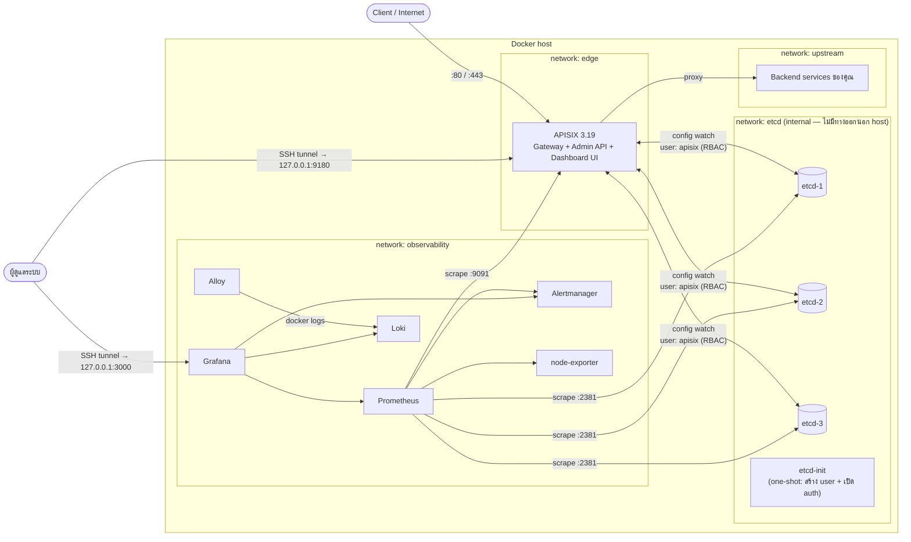

# Apache APISIX — Production Deployment ด้วย Docker Compose

ชุด deploy **Apache APISIX 3.19** สำหรับใช้งาน production จริงบน Docker Compose ประกอบด้วย
etcd cluster 3 โหนด (เปิด auth + RBAC), Admin API ที่ถูกล็อกไว้เฉพาะ localhost, Dashboard UI ในตัว,
ระบบ monitoring (Prometheus + Alertmanager + Grafana), ระบบเก็บ log (Loki + Alloy)
และสคริปต์ backup / restore / smoke test ที่ทดสอบผ่านจริงแล้ว

> เวอร์ชันทั้งหมดตรวจสอบจาก Docker Hub / Quay / GitHub Releases ณ วันที่ **30 ก.ย. 2026**
> และ pin tag ไว้ทุกตัว (ไม่มี `latest`) — อัปเกรดได้ที่ไฟล์ `.env`

---

## สารบัญ

1. [สถาปัตยกรรม](#1-สถาปัตยกรรม)
2. [องค์ประกอบและเวอร์ชัน](#2-องค์ประกอบและเวอร์ชัน)
3. [แต่ละส่วนทำงานอย่างไร](#3-แต่ละส่วนทำงานอย่างไร)
4. [โครงสร้างไฟล์](#4-โครงสร้างไฟล์)
5. [ความต้องการของเครื่อง](#5-ความต้องการของเครื่อง-prerequisites)
6. [ขั้นตอน Deploy](#6-ขั้นตอน-deploy)
7. [การใช้งานหลัง Deploy](#7-การใช้งานหลัง-deploy)
8. [งาน Operation ประจำ](#8-งาน-operation-ประจำ)
9. [High Availability (หลายเครื่อง)](#9-high-availability-หลายเครื่อง)
10. [Security Checklist](#10-security-checklist)
11. [Troubleshooting](#11-troubleshooting)
12. [ผลการทดสอบ](#12-ผลการทดสอบ)

---

## 1. สถาปัตยกรรม



**พอร์ตที่เปิดบน host**

| พอร์ต host | ไปที่ | bind | หมายเหตุ |
|---|---|---|---|
| `80` | APISIX `9080` | `0.0.0.0` | HTTP traffic |
| `443` | APISIX `9443` | `0.0.0.0` | HTTPS traffic (HTTP/2) |
| `9180` | APISIX Admin API + Dashboard `/ui/` | **`127.0.0.1`** | เข้าผ่าน SSH tunnel / VPN เท่านั้น |
| `3000` | Grafana | **`127.0.0.1`** | profile `observability` |
| `9090` | Prometheus | **`127.0.0.1`** | profile `observability` |
| `9093` | Alertmanager | **`127.0.0.1`** | profile `observability` |

etcd, Loki, Alloy, node-exporter, APISIX metrics (`9091`) **ไม่ถูก publish ออก host เลย**

---

## 2. องค์ประกอบและเวอร์ชัน

| องค์ประกอบ | Image (pinned) | Profile | หน้าที่โดยย่อ |
|---|---|---|---|
| **Apache APISIX** | `apache/apisix:3.19.0-debian` | core | API Gateway — รับ traffic, route, auth, rate limit, TLS, Admin API, Dashboard UI |
| **etcd** ×3 | `quay.io/coreos/etcd:v3.7.2` | core | ฐานข้อมูล config ของ APISIX (Raft cluster ทนโหนดล่มได้ 1 โหนด) |
| **etcd-init** | build จาก `etcd/Dockerfile` (alpine `3.24.2` + etcdctl `v3.7.2`) | core | Job ครั้งเดียว: สร้าง user/role และเปิด etcd auth (รันซ้ำได้ปลอดภัย) |
| **Prometheus** | `prom/prometheus:v3.15.0` | observability | เก็บ metrics + ประเมิน alert rules |
| **Alertmanager** | `prom/alertmanager:v0.34.1` | observability | ส่ง alert ไป Slack / Email / Webhook, จัดกลุ่ม, ปิดเสียงซ้ำ |
| **Grafana** | `grafana/grafana:13.2.3` | observability | Dashboard (มี APISIX dashboard + datasource ติดตั้งให้อัตโนมัติ) |
| **Loki** | `grafana/loki:3.7.8` | observability | เก็บ log ของทุก container (retention 14 วัน) |
| **Grafana Alloy** | `grafana/alloy:v1.20.1` | observability | อ่าน log จาก Docker แล้วส่งเข้า Loki (แทน Promtail ที่ deprecated แล้ว) |
| **node-exporter** | `prom/node-exporter:v1.12.1` | observability | metrics ของเครื่อง host (CPU / RAM / disk) |
| demo-upstream | `nginx:1.31.6-alpine` | demo | backend ตัวอย่างสำหรับ smoke test เท่านั้น |

> **ทำไมไม่มี `apache/apisix-dashboard`?** — ตั้งแต่ APISIX 3.13 Dashboard ถูกฝังมาใน APISIX แล้ว
> (`deployment.admin.enable_admin_ui: true`) เข้าได้ที่ `http://127.0.0.1:9180/ui/` ส่วน image
> `apisix-dashboard` แยกตัวเก่า (3.0.1) หยุดพัฒนาแล้ว
>
> **ทำไม etcd ไม่ใช้ `bitnami/etcd`?** — Bitnami ย้าย image ฟรีไป legacy แล้ว จึงใช้ image official
> ของ etcd-io จาก `quay.io/coreos/etcd`

---

## 3. แต่ละส่วนทำงานอย่างไร

### 3.1 APISIX — API Gateway

APISIX คือ OpenResty (Nginx + LuaJIT) ที่โหลด config แบบ dynamic จาก etcd โดย **ไม่ต้อง reload**

**Request flow (traffic ปกติ)**

```
Client ─► :443 (TLS termination, เลือก cert ตาม SNI จาก etcd)
        ─► Router (match uri / host / method / header)
        ─► Plugins ตามลำดับ priority  (เช่น auth → limit-count → proxy-rewrite)
        ─► Load balancer (roundrobin / chash / ewma) + health check ของ upstream
        ─► Upstream (backend)
        ─► Plugins ช่วง response + log (prometheus, access log JSON → stdout)
```

**Config flow (ตอนเพิ่ม/แก้ route)**

```
คุณ ──PUT──► Admin API (:9180, ต้องมี X-API-KEY + มาจาก IP ที่อนุญาต)
          ──► เขียนลง etcd ใต้ prefix /apisix/...
          ──► ทุก worker ของ APISIX "watch" etcd อยู่ → ได้ config ใหม่ภายใน ~1 วินาที
```

ประเด็น production ที่ตั้งไว้ใน `apisix/config.yaml`:

| หัวข้อ | ค่าที่ตั้ง | เหตุผล |
|---|---|---|
| Admin key | อ่านจาก env `APISIX_ADMIN_KEY` / `APISIX_VIEWER_KEY` | ไม่ hardcode; `viewer` = อ่านอย่างเดียว |
| `allow_admin` | `127.0.0.0/24` + gateway IP (`.1`) ของแต่ละ docker network | container อื่น (เช่น Grafana) เรียก Admin API ไม่ได้ (ได้ 403) |
| `data_encryption.keyring` | `APISIX_ENCRYPTION_KEY` (32 ตัว = AES-256) | private key ของ SSL และ secret ของ plugin ถูกเข้ารหัสก่อนเก็บใน etcd |
| `status` `127.0.0.1:7085` | `/status/ready` | ใช้เป็น Docker healthcheck — จะ 200 เมื่อ **ทุก worker** sync config จาก etcd แล้ว |
| `enable_server_tokens: false` | | ไม่เปิดเผยเวอร์ชัน APISIX ใน header |
| `client_max_body_size: 20m` | | ค่า default ของ APISIX คือไม่จำกัด (0) |
| Access log | JSON → stdout | Alloy ส่งเข้า Loki แล้ว query เป็น field ได้ |
| `stop_signal: SIGQUIT` (compose) | + `worker_shutdown_timeout: 30s` | Nginx จะ **graceful shutdown** — request ที่ค้างอยู่ทำจนเสร็จก่อนปิด (SIGTERM ของ Docker ปกติ = ตัดทันที) |
| `ulimits nofile 65535`, `somaxconn 4096` | | รองรับ connection จำนวนมาก |
| Prometheus export `0.0.0.0:9091` | ไม่ publish ออก host | Prometheus scrape ผ่าน network ภายใน |

### 3.2 etcd cluster — ที่เก็บ config

- **3 โหนด** ใช้ Raft consensus ต้องมี quorum 2/3 จึงเขียนได้ → ล่มได้ 1 โหนดโดยระบบยังทำงานปกติ
  (ทดสอบแล้ว: หยุด etcd-1 แล้วยังสร้าง route ใหม่และ proxy traffic ได้)
- ถ้า etcd ล่ม **ทั้งหมด** APISIX **ยังรับ traffic ต่อได้** ด้วย config ล่าสุดที่ cache ไว้ในหน่วยความจำ
  แต่จะแก้ config ไม่ได้ และ alert `APISIXEtcdUnreachable` จะดัง
- อยู่บน network `etcd` แบบ `internal: true` → ไม่มี route ออกนอก host และไม่ publish port
- `auto-compaction 1h`, quota 4 GiB, metrics แยกพอร์ต `2381`

**etcd auth + RBAC (สร้างโดย `etcd-init`)**

| user | role / สิทธิ์ | ใช้ทำอะไร |
|---|---|---|
| `root` | root (ทุกอย่าง) | งานดูแลระบบ: backup, restore, defrag — **APISIX ไม่ได้ใช้** |
| `apisix` | readwrite เฉพาะ prefix `/apisix` | APISIX ใช้ต่อ etcd (least privilege — เขียนนอก prefix จะโดน `permission denied`) |
| `healthcheck` | **ไม่มี role เลย** | ใช้ใน Docker healthcheck: `etcdctl endpoint health` ได้ `permission denied` ซึ่ง etcdctl นับว่า healthy (พิสูจน์ว่าโหนดตอบและมี leader) |

`etcd-init` เป็น job แบบ idempotent — รันทุกครั้งที่ `docker compose up` ถ้า auth เปิดอยู่แล้วก็จะแค่
sync password ของ `apisix` / `healthcheck` ให้ตรงกับ `.env` แล้วจบ (exit 0) จากนั้น APISIX จึงเริ่ม
(`depends_on: service_completed_successfully`)

### 3.3 Prometheus + Alertmanager — Metrics & Alerts

- `scripts/bootstrap.sh` สร้าง **global rule** เปิด plugin `prometheus` ให้ทุก route
- Prometheus scrape: `apisix:9091`, `etcd-{1,2,3}:2381`, `node-exporter:9100`, และตัว monitoring stack เอง
- เก็บข้อมูล 30 วัน หรือไม่เกิน 20 GB (ปรับใน `.env`)
- Alert rules ใน `prometheus/rules/apisix.yml` (17 rules):

| กลุ่ม | Alert | ระดับ |
|---|---|---|
| APISIX | `APISIXDown`, `APISIXEtcdUnreachable`, `APISIXHigh5xxRate` (>5%) | critical |
| APISIX | `APISIXRoute5xxRate` (>10% ต่อ route), `APISIXHighLatencyP99` (>2s), `APISIXHighActiveConnections`, `APISIXSharedDictAlmostFull` | warning |
| etcd | `EtcdQuorumAtRisk`, `EtcdNoLeader` | critical |
| etcd | `EtcdMemberDown`, `EtcdFrequentLeaderChanges`, `EtcdDatabaseNearQuota`, `EtcdSlowFsync` | warning |
| Host | `HostHighCPU`, `HostLowMemory`, `HostDiskSpaceLow` | warning |
| Monitoring | `ScrapeTargetDown` | warning |

- Alertmanager: ค่าเริ่มต้นส่งไป receiver `default` ซึ่ง **ยังไม่ส่งไปไหน** —
  แก้ `alertmanager/alertmanager.yml` เปิด Slack / Email / Webhook ตามตัวอย่างในไฟล์
  (critical ส่งซ้ำทุก 1 ชม., warning ทุก 4 ชม., critical จะ inhibit warning ชื่อเดียวกัน)

### 3.4 Grafana — Dashboard

- Provision อัตโนมัติ: datasource **Prometheus / Loki / Alertmanager** + dashboard **APISIX Overview**
  (ดัดแปลงจาก dashboard ทางการของ APISIX, folder `APISIX`)
- ปิด sign-up, anonymous, analytics
- dashboard แนะนำให้ import เพิ่ม (Dashboards → New → Import):
  `1860` Node Exporter Full, `3070` etcd

### 3.5 Loki + Alloy — Centralized Logs

```
container stdout/stderr ─► Docker ─► Alloy (อ่านผ่าน docker.sock แบบ read-only)
   ─► ติด label: container, service, project, stream
   ─► ถ้าเป็น access log ของ APISIX: parse JSON แล้วติด label method, status_class (2xx/4xx/5xx)
   ─► Loki (เก็บ 14 วัน, compactor ลบของเก่าอัตโนมัติ)
```

ตัวอย่าง LogQL ใน Grafana → Explore → Loki:

```logql
{service="apisix", status_class="5xx"} | json
{service="apisix"} | json | request_time > 1
{service=~"etcd-.*"} |= "warn"
```

> label ที่ cardinality สูง (uri, ip) **ไม่** ทำเป็น label — ใช้ `| json` ตอน query แทน เพื่อไม่ให้ Loki บวม

---

## 4. โครงสร้างไฟล์

```
.
├── docker-compose.yml            # นิยามทุก service, network, volume, healthcheck, resource limit
├── env.example                   # template ของ .env (ไม่มี secret) — gen-secrets.sh คัดลอกเป็น .env
├── Makefile                      # คำสั่งลัด: make help
├── apisix/
│   └── config.yaml               # config หลักของ APISIX (อ่าน secret จาก env)
├── etcd/
│   ├── Dockerfile                # image "etcd-tools" = alpine + etcdctl/etcdutl
│   ├── init-auth.sh              # สร้าง root/apisix/healthcheck user + เปิด auth
│   └── restore.sh                # restore snapshot ลง volume ทั้ง 3 โหนด
├── prometheus/
│   ├── prometheus.yml            # scrape targets
│   └── rules/apisix.yml          # alert rules
├── alertmanager/alertmanager.yml # ช่องทางแจ้งเตือน
├── grafana/
│   ├── provisioning/             # datasource + dashboard provider
│   └── dashboards/apisix.json    # APISIX dashboard
├── loki/loki.yaml                # storage + retention
├── alloy/config.alloy            # pipeline เก็บ log
├── scripts/
│   ├── gen-secrets.sh            # สร้าง .env + สุ่ม secret ทั้งหมด
│   ├── bootstrap.sh              # ตั้ง global rule (prometheus)
│   ├── smoke-test.sh             # ทดสอบ end-to-end
│   ├── upload-ssl.sh             # อัปโหลด/ต่ออายุ TLS certificate
│   ├── etcd-backup.sh            # snapshot etcd → ./backups
│   ├── etcd-restore.sh           # restore cluster จาก snapshot
│   └── lib.sh                    # helper ที่สคริปต์อื่นใช้ร่วมกัน
└── backups/                      # ที่เก็บ snapshot (อยู่ใน .gitignore)
```

---

## 5. ความต้องการของเครื่อง (Prerequisites)

| รายการ | ขั้นต่ำ | แนะนำ |
|---|---|---|
| OS | Linux x86_64 / arm64 | Ubuntu 24.04 LTS / RHEL 9 |
| CPU / RAM | 2 vCPU / 4 GB (core) | 4 vCPU / 8 GB (core + observability) |
| Disk | 40 GB | SSD/NVMe — etcd ไวต่อ fsync latency มาก |
| Docker Engine | **28.0+** (ใช้ `gw_priority`) | ล่าสุด |
| Docker Compose | v2.33+ | ล่าสุด |
| เครื่องมือ | `openssl`, `curl`, `jq`, `make` | |

**ตั้งค่า host (Linux) ก่อน deploy**

```bash
# ไฟล์ descriptor และ network backlog
cat <<'EOF' | sudo tee /etc/sysctl.d/99-apisix.conf
fs.file-max = 1048576
net.core.somaxconn = 65535
net.ipv4.tcp_max_syn_backlog = 65535
net.ipv4.ip_local_port_range = 1024 65000
vm.max_map_count = 262144
EOF
sudo sysctl --system

# Docker log rotation ถูกตั้งใน compose แล้ว (50MB × 5 ไฟล์/container)
```

**Firewall** — Docker เขียน iptables เอง **ข้าม ufw/firewalld** ดังนั้น:
- พอร์ตที่ bind `0.0.0.0` (80/443) จะเปิดสู่ภายนอกแน่นอน
- พอร์ตอื่นใน stack นี้ bind `127.0.0.1` ไว้แล้วจึงปลอดภัย — **อย่าเปลี่ยน** `APISIX_ADMIN_BIND` / `OBS_BIND` เป็น `0.0.0.0`
- ถ้าต้องจำกัด IP ที่เข้า 80/443 ให้ใช้ chain `DOCKER-USER` หรือ security group ของ cloud

---

## 6. ขั้นตอน Deploy

### 6.1 เตรียมไฟล์

```bash
sudo mkdir -p /opt/apisix && sudo chown $USER /opt/apisix
# คัดลอก repo นี้ไปไว้ที่ /opt/apisix (git clone / scp / rsync)
cd /opt/apisix
```

### 6.2 สร้าง `.env` และ secret

```bash
./scripts/gen-secrets.sh        # หรือ: make secrets
```

สคริปต์จะคัดลอก `env.example` → `.env`, สุ่มค่าทุกตัวที่เป็น `__GENERATE__` (128-bit) และตั้ง permission `600`
จากนั้นแก้ค่าที่ต้องปรับตามสภาพแวดล้อม:

| ตัวแปร | ต้องแก้เมื่อ |
|---|---|
| `TZ` | timezone ของ log |
| `GRAFANA_ROOT_URL` | ถ้าจะเปิด Grafana ผ่านโดเมน |
| `EDGE_SUBNET` / `OBSERVABILITY_SUBNET` / `UPSTREAM_SUBNET` และ `ADMIN_ALLOW_GW_*` | subnet `172.30.0-2.0/24` ชนกับ LAN/VPN ของบริษัท (เปลี่ยนคู่กัน: gateway = `.1` ของ subnet) |
| `APISIX_CPUS` / `APISIX_MEMORY` | ขนาดเครื่อง |

> ⚠️ **สำรอง `APISIX_ENCRYPTION_KEY` และ `ETCD_ROOT_PASSWORD` ไว้ใน password vault ทันที**
> ถ้าทำ `APISIX_ENCRYPTION_KEY` หาย จะถอดรหัส SSL private key ที่เก็บใน etcd ไม่ได้อีก (แม้มี backup)

### 6.3 ตรวจ config และดึง image

```bash
make config      # docker compose config --quiet → "compose OK"
make pull        # ดึง image ทั้งหมดที่ pin ไว้
```

### 6.4 Start

```bash
make up          # gateway + observability  (= docker compose --profile observability up -d --build --wait)
# หรือ
make up-core     # เฉพาะ etcd + APISIX (ถ้ามีระบบ monitoring กลางอยู่แล้ว)
```

ลำดับการ start ที่ compose จัดการให้:

```
etcd-1, etcd-2, etcd-3  ──(healthy)──►  etcd-init  ──(exit 0)──►  apisix  ──(/status/ready = 200)──► healthy
```

ตรวจสถานะ:

```bash
make ps
# apisix   Up (healthy)
# etcd-1/2/3  Up (healthy)
# etcd-init   Exited (0)     ← ปกติ เป็น job ครั้งเดียว
```

### 6.5 Bootstrap และ smoke test

```bash
make bootstrap   # เปิด prometheus plugin แบบ global
make smoke       # สร้าง route ทดสอบ → ยิง traffic → ตรวจ metrics → ลบทิ้ง
```

ผลที่ถูกต้อง:

```
==> Admin API auth
  [OK]   no key -> 401
  [OK]   admin key accepted
  [OK]   viewer key cannot write (401)
==> create demo upstream + route
  [OK]   upstream
  [OK]   route
==> proxy traffic
  [OK]   GET /smoke/ -> 200
  [OK]   unknown route -> 404
==> metrics (...)
  [OK]   apisix_http_status{route=smoke-demo} exported
  [OK]   apisix_etcd_reachable = 1
==> cleanup
  [OK]   demo route/upstream removed
ALL CHECKS PASSED
```

หลังทดสอบเสร็จ หยุด demo upstream ได้: `docker compose --profile demo stop demo-upstream`

### 6.6 ตั้ง backup อัตโนมัติ

```bash
crontab -e
# ทุกวัน 02:00
0 2 * * * cd /opt/apisix && ./scripts/etcd-backup.sh >> backups/backup.log 2>&1
```

แล้วตั้งให้ sync `backups/` ออกนอกเครื่อง (S3 / NAS) ด้วย

---

## 7. การใช้งานหลัง Deploy

### 7.1 เข้า Dashboard / Grafana จากเครื่องตัวเอง (SSH tunnel)

```bash
ssh -N -L 9180:127.0.0.1:9180 -L 3000:127.0.0.1:3000 -L 9090:127.0.0.1:9090 user@gateway-host
```

| เปิด | URL | login |
|---|---|---|
| APISIX Dashboard | http://localhost:9180/ui/ | ใส่ `APISIX_ADMIN_KEY` (หรือ `APISIX_VIEWER_KEY` สำหรับดูอย่างเดียว) |
| Grafana | http://localhost:3000 | `GRAFANA_ADMIN_USER` / `GRAFANA_ADMIN_PASSWORD` |
| Prometheus | http://localhost:9090 | — |

### 7.2 สร้าง Upstream + Route ผ่าน Admin API

```bash
source .env
ADMIN=http://127.0.0.1:9180/apisix/admin

# Upstream พร้อม active health check
curl -sS -X PUT $ADMIN/upstreams/orders -H "X-API-KEY: $APISIX_ADMIN_KEY" -d '{
  "name": "orders-service",
  "type": "roundrobin",
  "nodes": { "10.0.1.11:8080": 1, "10.0.1.12:8080": 1 },
  "timeout": { "connect": 3, "send": 30, "read": 30 },
  "retries": 1,
  "checks": {
    "active": { "type": "http", "http_path": "/health",
      "healthy":   { "interval": 5, "successes": 2 },
      "unhealthy": { "interval": 5, "http_failures": 3 } }
  }
}'

# Route: /api/orders/* → orders, ต้องมี API key + rate limit 100 req/นาที ต่อ consumer
curl -sS -X PUT $ADMIN/routes/orders -H "X-API-KEY: $APISIX_ADMIN_KEY" -d '{
  "name": "orders-api",
  "uri": "/api/orders/*",
  "hosts": ["api.example.com"],
  "methods": ["GET", "POST", "PUT", "DELETE"],
  "upstream_id": "orders",
  "plugins": {
    "key-auth": {},
    "limit-count": { "count": 100, "time_window": 60, "key_type": "var", "key": "consumer_name", "rejected_code": 429 },
    "proxy-rewrite": { "regex_uri": ["^/api/orders/(.*)", "/$1"] }
  }
}'

# Consumer (ผู้เรียก API) — key จะถูกเข้ารหัสก่อนเก็บใน etcd
curl -sS -X PUT $ADMIN/consumers -H "X-API-KEY: $APISIX_ADMIN_KEY" -d '{
  "username": "mobile_app",
  "plugins": { "key-auth": { "key": "'"$(openssl rand -hex 24)"'" } }
}'
```

> ถ้า backend รันเป็น container บนเครื่องเดียวกัน ให้ต่อเข้า network `upstream`
> (`networks: [apisix_upstream]` แบบ `external: true` ใน compose ของ backend) แล้วใช้ชื่อ service เป็น node

### 7.3 TLS Certificate

```bash
./scripts/upload-ssl.sh api-example-com /path/fullchain.pem /path/privkey.pem api.example.com '*.api.example.com'
```

- APISIX เลือก cert ตาม SNI อัตโนมัติ, private key ถูก AES-256 encrypt ก่อนลง etcd (ทดสอบแล้ว: ค่าใน etcd ไม่ใช่ plaintext)
- ต่ออายุ: รันคำสั่งเดิมด้วย id เดิม — มีผลทันทีไม่ต้อง restart
- Let's Encrypt: ใช้ certbot / acme.sh แบบ DNS-01 บน host แล้วใส่คำสั่งข้างบนเป็น deploy-hook
- บังคับ HTTPS: ใส่ plugin `"redirect": {"http_to_https": true}` ใน route

### 7.4 อยู่หลัง Load Balancer (ได้ IP จริงของ client)

แก้ `apisix/config.yaml`:

```yaml
apisix:
  trusted_addresses:
    - 10.0.0.0/8                 # CIDR ของ LB
nginx_config:
  http:
    real_ip_header: X-Forwarded-For
    real_ip_recursive: "on"
    real_ip_from:
      - 10.0.0.0/8
```

แล้ว `docker compose up -d apisix` (config.yaml เปลี่ยน = ต้อง recreate container)

---

## 8. งาน Operation ประจำ

### 8.1 คำสั่งที่ใช้บ่อย

```bash
make help                           # รายการคำสั่ง
make ps                             # สถานะ
make logs                           # log APISIX แบบ follow
docker compose logs etcd-init       # ดูผลการตั้งค่า etcd auth
docker compose exec etcd-1 etcdctl --user "root:$ETCD_ROOT_PASSWORD" endpoint status -w table \
  --endpoints=http://etcd-1:2379,http://etcd-2:2379,http://etcd-3:2379
make reload-prom                    # reload Prometheus หลังแก้ rules (ไม่ต้อง restart)
```

### 8.2 เปลี่ยน config

| สิ่งที่เปลี่ยน | วิธี | downtime |
|---|---|---|
| route / upstream / plugin / consumer / SSL | Admin API หรือ Dashboard | ไม่มี (มีผลใน ~1 วินาที) |
| `apisix/config.yaml` | `docker compose up -d apisix` | สั้นมาก (graceful — request ที่ค้างทำจนเสร็จ) — ถ้าต้องการ zero-downtime ดู [ข้อ 9](#9-high-availability-หลายเครื่อง) |
| alert rules | แก้ไฟล์ แล้ว `make reload-prom` | ไม่มี |
| `alertmanager.yml` | `docker compose restart alertmanager` | ไม่กระทบ traffic |

### 8.3 Backup & Restore

**Backup** (snapshot = config ทั้งหมดของ APISIX + users ของ etcd)

```bash
make backup
# backup: backups/etcd-snapshot-20260930-111315.db
```

**Restore** (แทนที่ข้อมูล etcd ทั้ง 3 โหนด — ทำตอนเกิดเหตุเท่านั้น)

```bash
./scripts/etcd-restore.sh etcd-snapshot-20260930-111315.db
# พิมพ์ 'restore' เพื่อยืนยัน → หยุด apisix+etcd → restore → start → รอ healthy
./scripts/smoke-test.sh
```

ขั้นตอนภายใน: หยุด APISIX และ etcd → container `etcd-restore` (ไม่มี network) ลบ `member/` ของทั้ง 3 volume
แล้วใช้ `etcdutl snapshot restore` สร้างข้อมูลใหม่ด้วย cluster token ใหม่ → start กลับ

> ต้องใช้ `.env` ชุดเดิม (โดยเฉพาะ `APISIX_ENCRYPTION_KEY`) ไม่อย่างนั้น SSL/secret ที่ restore มาจะถอดรหัสไม่ได้

### 8.4 อัปเกรดเวอร์ชัน

1. อ่าน [CHANGELOG ของ APISIX](https://github.com/apache/apisix/blob/master/CHANGELOG.md) — มองหา breaking change / config ที่เปลี่ยน
2. `make backup`
3. แก้ tag ใน `.env` (เช่น `APISIX_IMAGE=apache/apisix:3.20.0-debian`)
4. ทดสอบบน staging ด้วย `.env` เดียวกันก่อน
5. `docker compose pull apisix && docker compose up -d apisix && make smoke`
6. ถ้ามีปัญหา: เปลี่ยน tag กลับ แล้ว `docker compose up -d apisix`

etcd: อัปเกรดทีละ **minor version** (3.6 → 3.7) ทีละโหนด —
`docker compose up -d --no-deps etcd-1` → รอ healthy → etcd-2 → etcd-3

### 8.5 Rotate secret

| Secret | วิธี rotate |
|---|---|
| `APISIX_ADMIN_KEY` / `VIEWER_KEY` | แก้ `.env` → `docker compose up -d apisix` |
| `ETCD_APISIX_PASSWORD` | แก้ `.env` → `docker compose up -d` (etcd-init sync password ให้ แล้ว recreate apisix) |
| `ETCD_HEALTHCHECK_PASSWORD` | แก้ `.env` → `docker compose up -d` |
| `ETCD_ROOT_PASSWORD` | `docker compose exec etcd-1 etcdctl --user root:<เก่า> user passwd root` → แก้ `.env` ให้ตรง |
| `APISIX_ENCRYPTION_KEY` | **ห้ามแทนที่** — เพิ่ม key ใหม่เป็นบรรทัดแรกของ `keyring` ใน `config.yaml` และเก็บ key เก่าไว้ด้านล่าง แล้วอัปโหลด SSL/consumer ใหม่เพื่อให้ถูกเข้ารหัสด้วย key ใหม่ |
| `GRAFANA_ADMIN_PASSWORD` | เปลี่ยนใน Grafana UI (ค่าใน env ใช้แค่ตอนสร้างครั้งแรก) |

### 8.6 etcd maintenance

ถ้า alert `EtcdDatabaseNearQuota` ดัง:

```bash
source .env
EP=http://etcd-1:2379,http://etcd-2:2379,http://etcd-3:2379
docker compose exec etcd-1 etcdctl --user "root:$ETCD_ROOT_PASSWORD" --endpoints=$EP defrag
docker compose exec etcd-1 etcdctl --user "root:$ETCD_ROOT_PASSWORD" --endpoints=$EP alarm disarm
```

(defrag จะ block โหนดนั้นชั่วครู่ — ทำนอกช่วง peak)

---

## 9. High Availability (หลายเครื่อง)

**ข้อจำกัดของการรันบนเครื่องเดียว:** etcd 3 โหนดบน host เดียวช่วยเรื่อง process ล่ม / อัปเกรดทีละโหนด
แต่ **ถ้าเครื่องล่ม ทุกอย่างล่มพร้อมกัน** สำหรับ production ที่ต้องการ HA จริง:

```
                  ┌──────── L4/L7 Load Balancer (health check: TCP :443 หรือ route /healthz) ────────┐
                  ▼                                  ▼                                  ▼
           Host A: APISIX                     Host B: APISIX                     Host C: APISIX (optional)
                  │                                  │                                  │
                  └─────────────── etcd-1 (Host A) ─ etcd-2 (Host B) ─ etcd-3 (Host C) ─┘
```

แนวทางดัดแปลง stack นี้:

0. สร้าง route สำหรับ LB health check (ตอบจาก APISIX เองโดยไม่ไป upstream):
   ```bash
   curl -sS -X PUT $ADMIN/routes/lb-healthz -H "X-API-KEY: $APISIX_ADMIN_KEY" -d '{
     "uri": "/healthz", "plugins": { "mocking": { "response_status": 200, "response_example": "ok" } } }'
   ```

1. แต่ละ host รัน **etcd 1 โหนด** โดยแก้ `ETCD_INITIAL_CLUSTER` / `ADVERTISE_*` เป็น IP จริงของแต่ละ host และ publish `2379/2380` เฉพาะ private network
2. เปิด **TLS ระหว่าง etcd peer และ client** (`ETCD_CERT_FILE`, `ETCD_PEER_*`, และ `deployment.etcd.tls` ใน APISIX) เพราะ traffic ออกนอก host แล้ว
3. APISIX ทุก host ชี้ `deployment.etcd.host` ไปที่ etcd ทั้ง 3 IP — config ที่แก้ที่ host ไหนก็กระจายไปทุก host
4. Rolling update ทีละ host: ถอดออกจาก LB → `docker compose up -d apisix` → smoke test → ใส่กลับ = **zero downtime**
5. Prometheus scrape ทุก host (หรือใช้ remote_write ไป Prometheus / Mimir กลาง), Loki ย้าย storage ไป S3/MinIO

ทางเลือกที่ใหญ่กว่านี้: Kubernetes + [APISIX Helm chart](https://github.com/apache/apisix-helm-chart) หรือ APISIX Ingress Controller

---

## 10. Security Checklist

- [x] Admin API bind `127.0.0.1` + `allow_admin` เฉพาะ gateway IP + ต้องมี API key (ทดสอบ: container อื่นได้ 403)
- [x] แยก key `admin` (เขียน) / `viewer` (อ่านอย่างเดียว)
- [x] etcd auth + RBAC least privilege, network `internal`, ไม่ publish port
- [x] SSL private key / plugin secret เข้ารหัส AES-256 ใน etcd
- [x] ไม่มี secret ใน git (`.env` อยู่ใน `.gitignore`, mode 600)
- [x] `no-new-privileges`, resource limits, log rotation ทุก container
- [x] ซ่อนเวอร์ชันใน `Server` header, จำกัด body size, TLS 1.2+ เท่านั้น, ปิด session tickets
- [x] Grafana ปิด sign-up / anonymous
- [ ] **คุณต้องทำเอง:** ตั้ง receiver ของ Alertmanager
- [ ] **คุณต้องทำเอง:** ตั้ง cron backup + sync ออกนอกเครื่อง
- [ ] **คุณต้องทำเอง:** เก็บ `.env` สำเนาใน vault (1Password / Vault / Secrets Manager)
- [ ] **คุณต้องทำเอง:** ใส่ `real_ip_from` / `trusted_addresses` ถ้าอยู่หลัง LB
- [ ] แนะนำ: เปิด plugin ป้องกันระดับ route เช่น `limit-req`, `ip-restriction`, `cors`, `request-validation`, WAF (`chaitin-waf`)
- [ ] แนะนำ: สแกน image เป็นระยะ (`docker scout cves apache/apisix:3.19.0-debian` หรือ Trivy)

---

## 11. Troubleshooting

| อาการ | สาเหตุ / วิธีแก้ |
|---|---|
| `apisix` ไม่ start, `etcd-init` exit ≠ 0 | `docker compose logs etcd-init` — ส่วนใหญ่เป็น `ETCD_ROOT_PASSWORD` ใน `.env` ไม่ตรงกับที่ตั้งไว้ใน etcd |
| `apisix` unhealthy | `docker compose logs apisix` — ถ้าเห็น `etcd` error ตรวจ `ETCD_APISIX_PASSWORD`; ถ้าเห็น `failed to parse yaml` ตรวจ `config.yaml` |
| Admin API ได้ **403** | request ไม่ได้มาจาก IP ที่อนุญาต — ตรวจว่า `ADMIN_ALLOW_GW_*` ตรงกับ subnet (`docker network inspect apisix_edge`) และดู IP ที่ถูก block ใน `docker compose logs apisix \| grep forbidden` |
| Admin API ได้ **401** | key ผิด / ไม่ได้ส่ง header `X-API-KEY` |
| Route ได้ **404** `{"error_msg":"404 Route Not Found"}` | ไม่มี route match — ตรวจ `uri`, `hosts`, `methods` |
| **502 / 504** | upstream ล่มหรือ timeout — ดูสถานะ health check ของ upstream ผ่าน Control API: `docker compose exec apisix bash -c 'exec 3<>/dev/tcp/127.0.0.1/9090; printf "GET /v1/healthcheck HTTP/1.0\r\n\r\n" >&3; cat <&3'` และดู `upstream_status` ใน Loki: `{service="apisix", status_class="5xx"} \| json` |
| etcd unhealthy หลัง reboot | ต้องมีอย่างน้อย 2/3 โหนดขึ้นพร้อมกันจึงจะเลือก leader ได้ — `docker compose up -d` |
| alert `EtcdSlowFsync` | disk ช้า (เจอบ่อยบน VM / network storage) → ย้าย volume ไป SSD local |
| log etcd: `simple token is not cryptographically signed` | คำเตือนปกติของ etcd auth แบบ simple token ใช้ได้เมื่อ etcd อยู่ใน network ปิด; ถ้าต้องการ JWT ให้ตั้ง `ETCD_AUTH_TOKEN=jwt,...` พร้อม key pair |
| log APISIX `[warn] ... new plugins: {...}` ตอน start | ปกติ — เป็นรายการ plugin ที่โหลด |
| Metrics ใหม่ยังไม่ขึ้น | exporter cache ข้อมูล 15 วินาที (`refresh_interval`) และต้องรัน `make bootstrap` แล้ว |

---

## 12. ผลการทดสอบ

stack นี้ถูก deploy และทดสอบจริง (Docker 29.4 / Compose v5.1, 30 ก.ย. 2026):

| การทดสอบ | ผล |
|---|---|
| Fresh install (`down -v` → `up`) ทุก service healthy | ✅ |
| Restart ทั้ง stack (จำลอง reboot) — etcd-init idempotent, APISIX healthy | ✅ |
| Smoke test: auth 401, viewer เขียนไม่ได้, route → upstream 200, 404, metrics | ✅ |
| etcd RBAC: anonymous ถูกปฏิเสธ, user `apisix` เขียนนอก `/apisix` → permission denied | ✅ |
| หยุด etcd 1 โหนด → ยังสร้าง route และ proxy traffic ได้ | ✅ |
| Admin API จาก host 30/30 ครั้ง = 200, จาก container อื่น = 403 | ✅ |
| อัปโหลด SSL → key ใน etcd ถูกเข้ารหัส → HTTPS ตาม SNI = 200 | ✅ |
| Backup → ลบ route + SSL → restore → route และ HTTPS กลับมา | ✅ |
| Graceful shutdown: request ที่ค้างระหว่าง `stop` ได้ 200, exit code 0 | ✅ |
| Prometheus: 10 targets up, 17 rules healthy; Grafana datasource + dashboard; Loki มี log + label `status_class` | ✅ |
| `shellcheck` ทุกสคริปต์ | ✅ |
